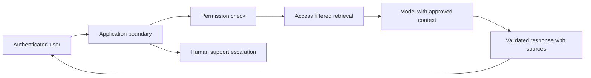

# Architecture and rendering decisions

Begin with a workflow inventory rather than a framework diagram. Identify actors, records and transitions. For each transition describe permission checks, authoritative data and a recoverable failure. This produces a design that can be reviewed against business requirements before screens are built.

## Architectural decision checklist

- [ ] Identify public, authenticated and tenant-restricted routes.
- [ ] Define the authoritative source and owner for each record type.
- [ ] Specify freshness requirements for public and private information.
- [ ] Keep browser-only interaction in a proportionate Client Component boundary.
- [ ] Inspect data crossing the server/client boundary for unintended disclosure.
- [ ] Provide meaningful loading, empty, validation and dependency-failure states.
- [ ] Document transactions, background work and duplicate-event handling.
- [ ] Agree deployment limits, observability and recovery ownership.
- [ ] Record rejected alternatives and why the chosen approach fits.

App Router layouts, route groups and dynamic routes should reflect the product's navigation. Server Components suit server-side composition; Client Components supply browser interactions. Rendering on the server does not make output private: only send information the requesting user may receive. Streaming and Suspense should improve perceived response without placing sensitive data in an inappropriate public boundary.

## Illustrative support portal

The diagram describes a possible architecture, not a deployed OzairWebs system. Retrieval filtering occurs before model access. Tool execution would require its own authorization boundary. A model-generated instruction cannot grant access to additional records.

TypeScript interfaces help communicate contracts but do not validate hostile runtime input. Route Handlers and Server Actions need independent input and permission checks. Internationalisation requires a URL/content model and owned translation workflow. Accessibility belongs in design acceptance: labels, focus, navigation and error recovery are functional requirements.

Record decisions using the [architecture template](../examples/README.md). Consult [Next.js component documentation](https://nextjs.org/docs/app/getting-started/server-and-client-components) and [React Server Components](https://react.dev/reference/rsc/server-components), then verify against the installed release.
